# Biblioteca de handraisers — corpus visual

36 archivos originales; cada montaje se interpreta de izquierda a derecha. 1–25 en orden numérico y capturas en orden cronológico. No se concatenan montajes automáticamente. Los textos de abajo son síntesis de lectura visual, no transcripciones literales completas; las imágenes son la fuente primaria. Las cifras son afirmaciones visibles, no resultados verificados. Los clips con icono de reproducción no incluyen audio.

## E01 — Contraste malo/bueno

- Original: `1.png`. Pantallas visibles: 4.
- Recorrido: Opinión negativa sobre algo visto → qué es algo bien, con resultados → PDF con información → laptop y CTA PDF repetido.
- Composición: Selfie expresiva, capturas comparativas, documento y foto de laptop.
- Lectura psicológica (inferencia): Contraste de estándares, evidencia y recurso tangible; repetición del CTA.
- Referencia visual: [abrir original](referencias/01.png).

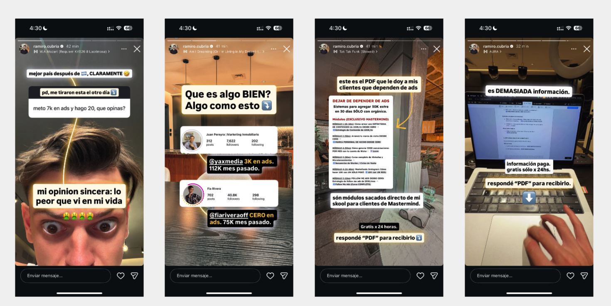

## E02 — Arrepentimiento del alumno

- Original: `2.png`. Pantallas visibles: 3.
- Recorrido: Mi alumno tal vez se enoje conmigo por esto → hace dos horas le mandé una clase y esta fue su reacción → probablemente se enoje por dar esto gratis; respondé conversación.
- Composición: Fotos oscuras, caja blanca, chat y esquema.
- Lectura psicológica (inferencia): Conflicto anticipado, proximidad temporal, reacción y acceso.
- Referencia visual: [abrir original](referencias/02.png).

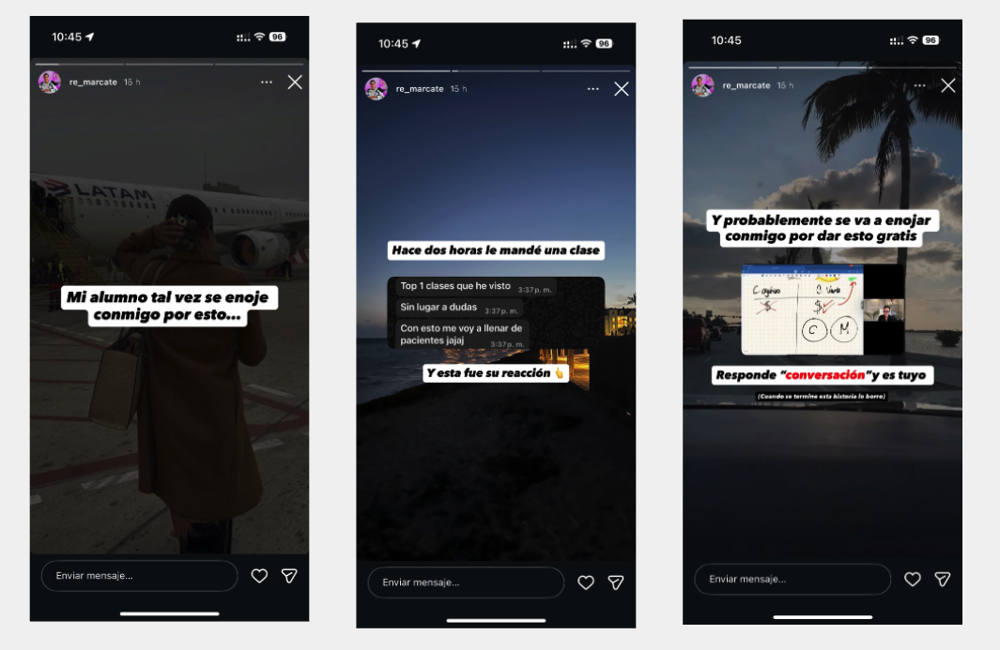

## E03 — Enemigo común

- Original: `3.png`. Pantallas visibles: 4.
- Recorrido: Varios comunistas me van a odiar → a mis clientes y a mí nos encanta la plata → reacción del cliente al video privado → ¿Lo querés? Respondé YO.
- Composición: Rojo plano, selfie, negro con chat, foto de laptop.
- Lectura psicológica (inferencia): Polarización, identidad, brecha de información, CTA mínimo.
- Referencia visual: [abrir original](referencias/03.png).

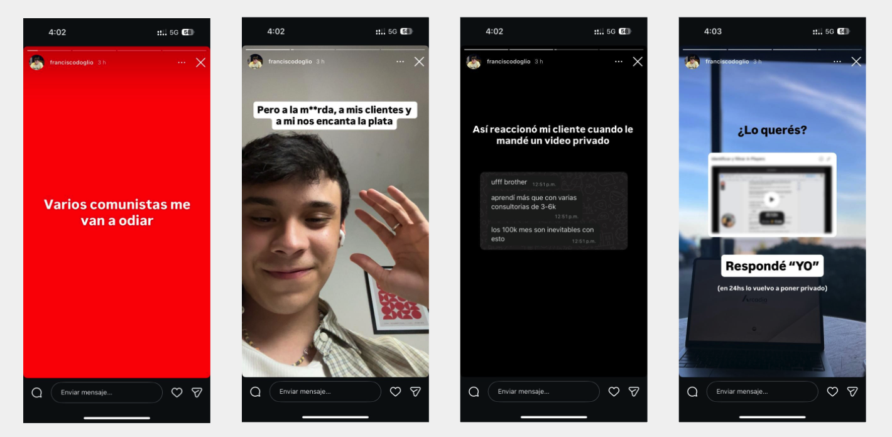

## E04 — Microlanzamiento

- Original: `4.png`. Pantallas visibles: 3.
- Recorrido: ¿Querés aprovechar enero y meter un récord? → evento especial solo por historias, cero ads; resultados → módulo de microlanzamientos y respondé YO.
- Composición: Foto con dinero, flecha amarilla, capturas, portada de módulo.
- Lectura psicológica (inferencia): Oportunidad temporal, mecanismo nombrado, evidencia y acceso.
- Referencia visual: [abrir original](referencias/04.png).

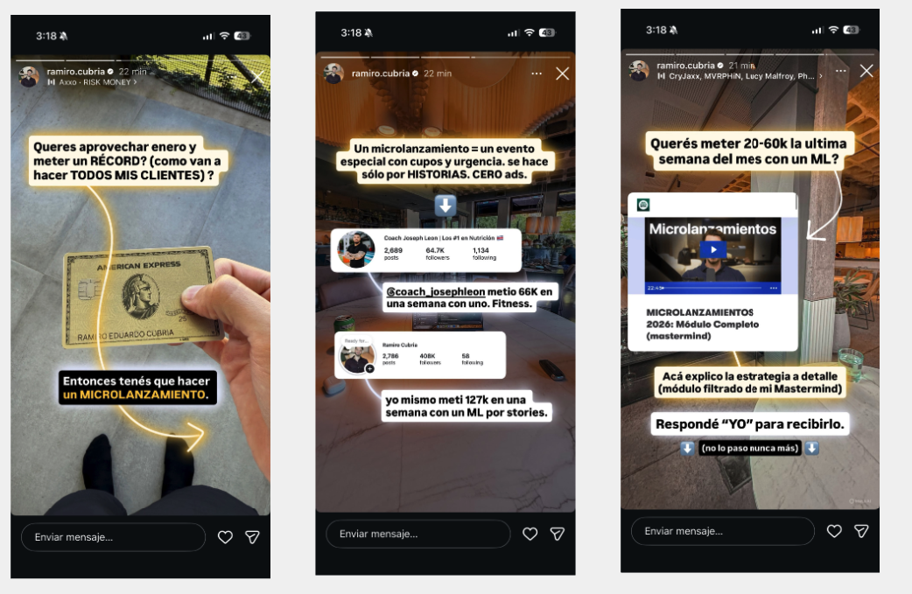

## E05 — Disciplina de trading

- Original: `5.png`. Pantallas visibles: 4.
- Recorrido: No hizo nada el Nasdaq → reflexión sobre esperar oportunidades → invitación a ver un live/backtesting → gráfico y respondé LIVE.
- Composición: Gráfico oscuro, selfie, playa, captura de gráfico.
- Lectura psicológica (inferencia): Contrarian hook, credibilidad por proceso, invitación específica.
- Referencia visual: [abrir original](referencias/05.png).

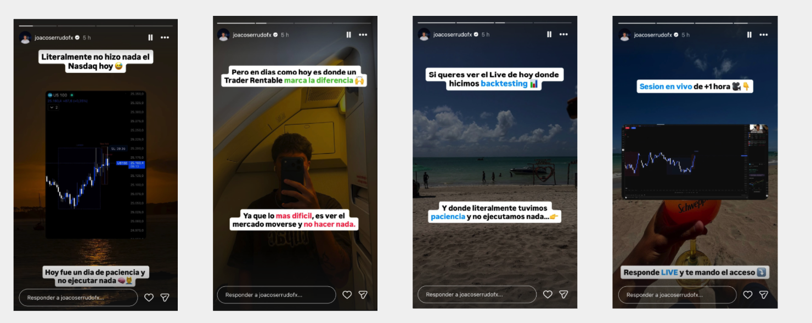

## E06 — Carpeta premium

- Original: `6.png`. Pantallas visibles: 3.
- Recorrido: El club de los vende humo me va a cancelar → voy a dar gratis algo mejor que lo que venden a 297 USD → carpeta con cinco clases; respondé 5.
- Composición: Ciudad nocturna, selfie exterior, icono de carpeta y CTA azul.
- Lectura psicológica (inferencia): Enemigo, anclaje de precio, paquete tangible, arrepentimiento.
- Referencia visual: [abrir original](referencias/06.png).

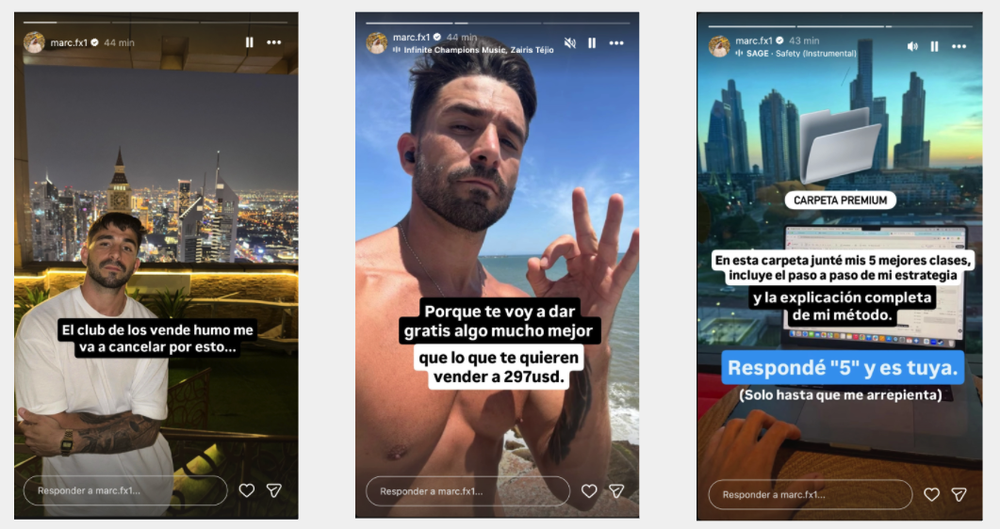

## E07 — Demanda social

- Original: `7.png`. Pantallas visibles: 3.
- Recorrido: Pasó algo el sábado → 25 personas aplicaron para formarse como ghostwriters → video explicando cómo funciona; respondé GHOST.
- Composición: Foto social, evento, mesa cotidiana, carteles rojo y azul.
- Lectura psicológica (inferencia): Acontecimiento, popularidad, curiosidad, incentivo de precio.
- Referencia visual: [abrir original](referencias/07.png).

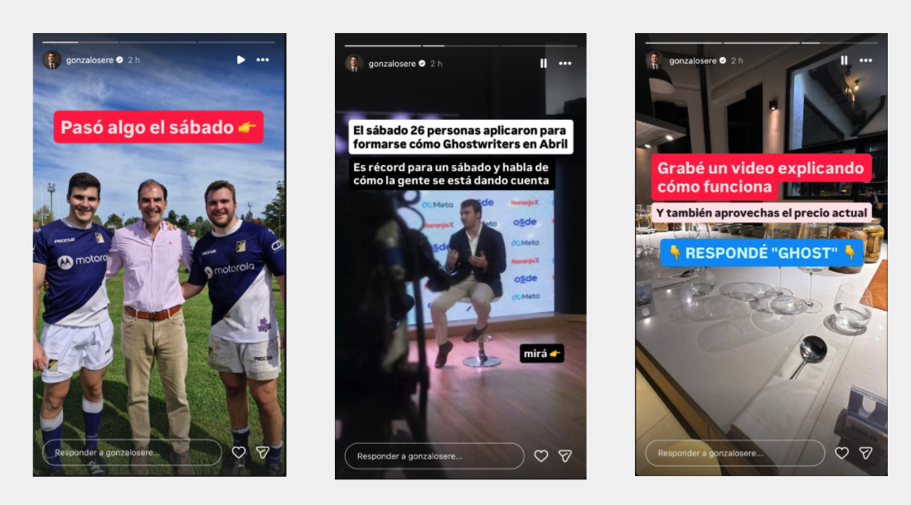

## E08 — Proceso completo

- Original: `8.png`. Pantallas visibles: 3.
- Recorrido: Un cliente me mandó esto → misma conversación ampliada, le pasé nuestro proceso completo → proceso de 7 páginas; respondé PDF.
- Composición: Fondo oscuro constante, chat acumulativo y mockup de documento.
- Lectura psicológica (inferencia): Prueba progresiva, continuidad visual, especificidad del recurso.
- Referencia visual: [abrir original](referencias/08.png).

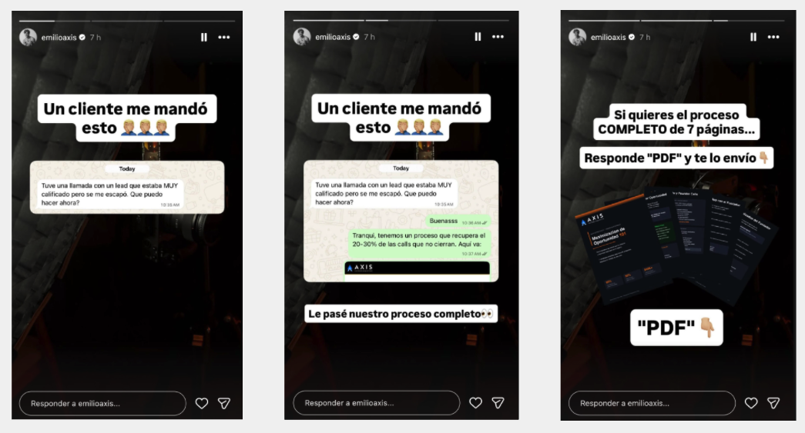

## E09 — Ranking y objeción

- Original: `9.png`. Pantallas visibles: 4.
- Recorrido: Imagen conmemorativa → murió de risa ante objeción de ingresos → mirá este ranking → ¿hace falta una formación específica para ser closer? NO; vos podés ser el próximo.
- Composición: Retrato monocromo, foto auto, ranking, mosaico de personas.
- Lectura psicológica (inferencia): Contraste emocional, evidencia y ruptura de objeción; CTA DM no visible con claridad.
- Referencia visual: [abrir original](referencias/09.png).

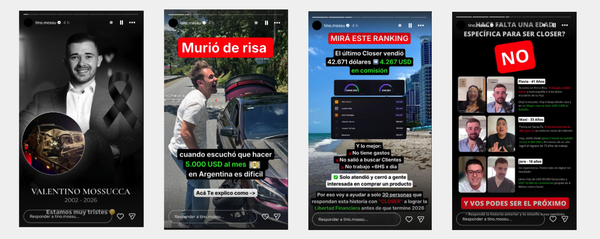

## E10 — Narrativa extensa de oportunidad

- Original: `10.png`. Pantallas visibles: 7.
- Recorrido: Fotos aspiracionales → explicación en carteles sucesivos → evidencia de operación y captura → conversación/reacciones al final.
- Composición: Escenas de viaje, auto, interior, pantalla de trading y chat.
- Lectura psicológica (inferencia): Escalada narrativa y prueba múltiple; texto pequeño no transcrito.
- Referencia visual: [abrir original](referencias/10.png).

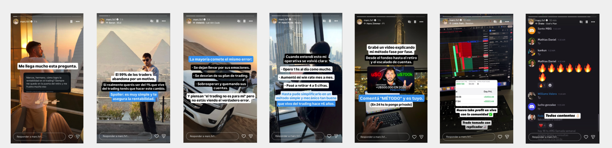

## E11 — Regalo limitado

- Original: `11.png`. Pantallas visibles: 2.
- Recorrido: Mis alumnos retiran todas las semanas gracias a cuentas de fondeo → regalar cuentas de 10K a los primeros 20; responde 10.
- Composición: Collage de capturas con trazo luminoso, foto trabajando, naranja.
- Lectura psicológica (inferencia): Prueba agrupada, cupo explícito y CTA numérico.
- Referencia visual: [abrir original](referencias/11.png).

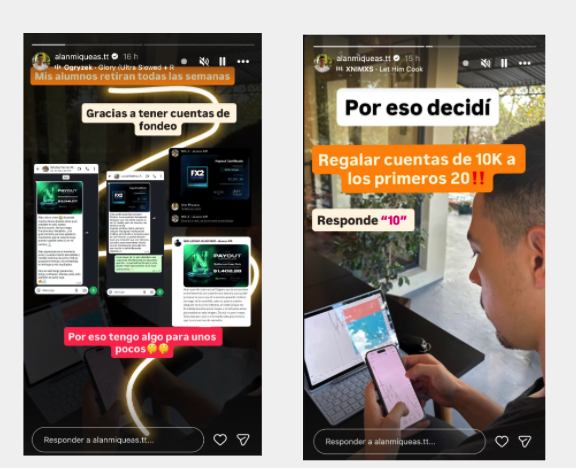

## E12 — Reacción y clase

- Original: `12.png`. Pantallas visibles: 2.
- Recorrido: Un alumno me mandó esto: No podes regalar esto, es una locura → mismo chat más imagen de clase de +3hs; mandame YO.
- Composición: Fondo oscuro repetido, título rojo, gráfico, CTA blanco y plazo rojo.
- Lectura psicológica (inferencia): Revelación acumulativa, reacción antes del recurso, plazo solo hoy.
- Referencia visual: [abrir original](referencias/12.png).

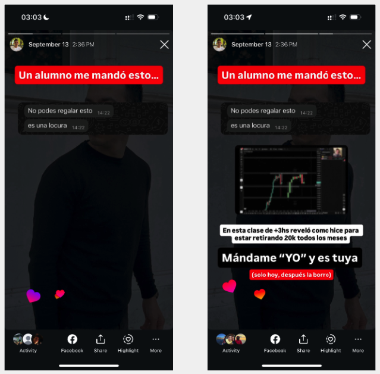

## E13 — Teléfono roto

- Original: `13.png`. Pantallas visibles: 4.
- Recorrido: Mi novia me rompió mi teléfono nuevo porque me encontró esto → conversación y problema de fondeo → tres componentes del método y resultado → clase y DM ROTO.
- Composición: Teléfono roto, selfie, chat, collage y gráfico.
- Lectura psicológica (inferencia): Gancho personal incongruente, puente al problema, mecanismo y CTA temático.
- Referencia visual: [abrir original](referencias/13.png).

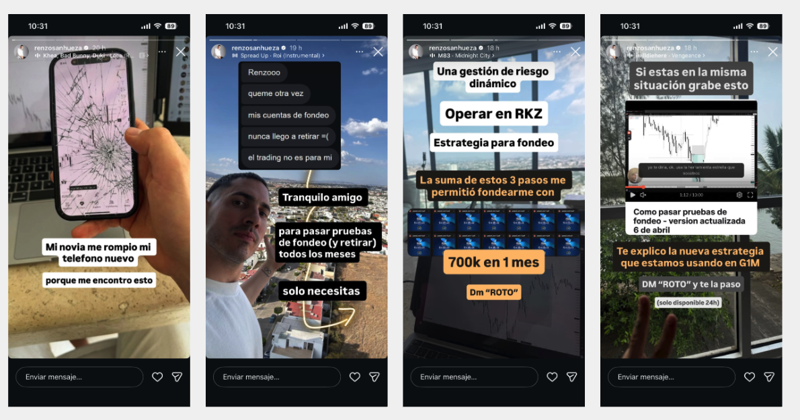

## E14 — Descubrimiento con rostro

- Original: `14.png`. Pantallas visibles: 5.
- Recorrido: Selfie con anuncio de secreto → vas a odiar esto → gráfico anotado → pieza visual morada → selfie y captura de reacción.
- Composición: Rostro recurrente, contraste rojo, anotaciones y recurso.
- Lectura psicológica (inferencia): Curiosidad, demostración y cambio visual; CTA pequeño no confirmado.
- Referencia visual: [abrir original](referencias/14.png).

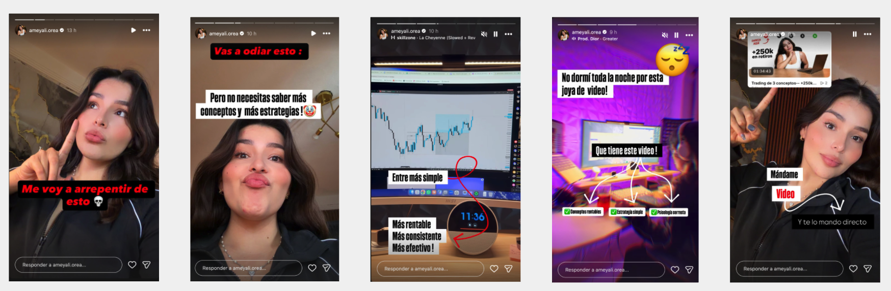

## E15 — Volvió a pasar

- Original: `15.png`. Pantallas visibles: 6.
- Recorrido: Volvió a pasar → alumno vuelve a aparecer en el relato → capturas y explicación → más pruebas → recurso → conversación final.
- Composición: Rojo plano, selfie, pantallas, fotos cotidianas y chat.
- Lectura psicológica (inferencia): Recurrencia, prueba escalonada, cierre social; texto fino no confirmado.
- Referencia visual: [abrir original](referencias/15.png).

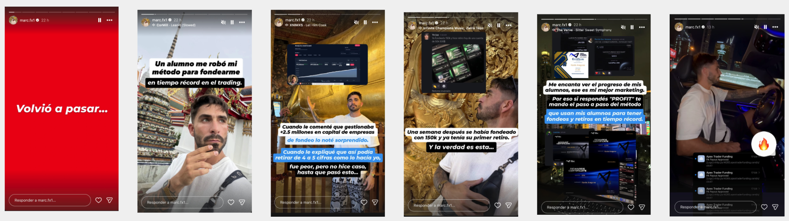

## E16 — Valija y carpeta

- Original: `16.png`. Pantallas visibles: 3.
- Recorrido: Me detuvieron saliendo de EE.UU. por lo que llevaba en la valija → carpeta con +20 horas de formación gratuita de closing; respondé CARPETA → volvé dos historias atrás, no tiene costo, la próxima la cobro.
- Composición: Selfie aeropuerto, laptop, foto llamada, rojo y blanco.
- Lectura psicológica (inferencia): Incongruencia, revelación, tangibilización y recuperación de indecisos.
- Referencia visual: [abrir original](referencias/16.png).

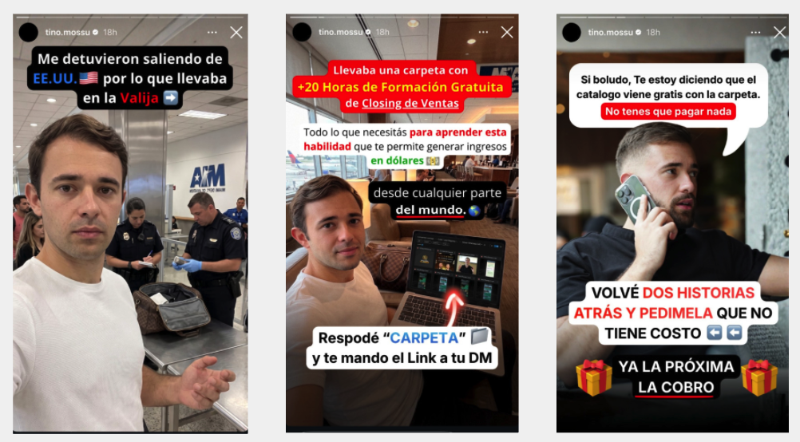

## E17 — El bebé

- Original: `17.png`. Pantallas visibles: 5.
- Recorrido: Va creciendo el bebé → plataforma gratis para aprender a hacer dinero online → oferta con palabra 10 → volvé que es gratis, la próxima la cobro → mosaico de resultados.
- Composición: Escena familiar, selfie, collage, auto y prueba social.
- Lectura psicológica (inferencia): Metáfora, revelación, CTA y refuerzo posterior.
- Referencia visual: [abrir original](referencias/17.png).

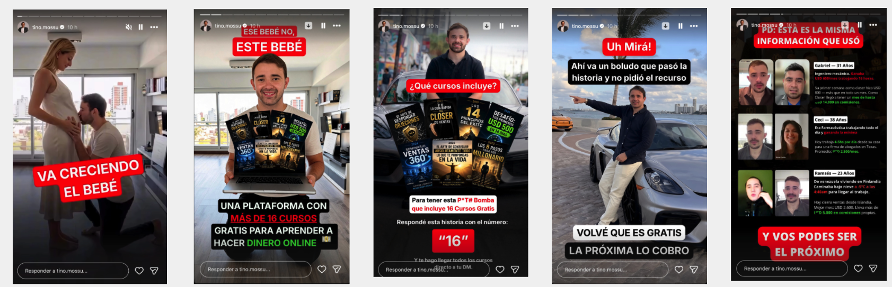

## E18 — IA y contenido

- Original: `18.png`. Pantallas visibles: 5.
- Recorrido: Escena personal → aprendiendo a usar IA → resultado de 36 días y SIMPLE → sistema de contenido en pantalla → selfie con CTA.
- Composición: Fotos orgánicas, laptop, negro y amarillo, captura y rostro.
- Lectura psicológica (inferencia): Simplificación, resultado, mecanismo y acceso; cifra fina no confirmada.
- Referencia visual: [abrir original](referencias/18.png).

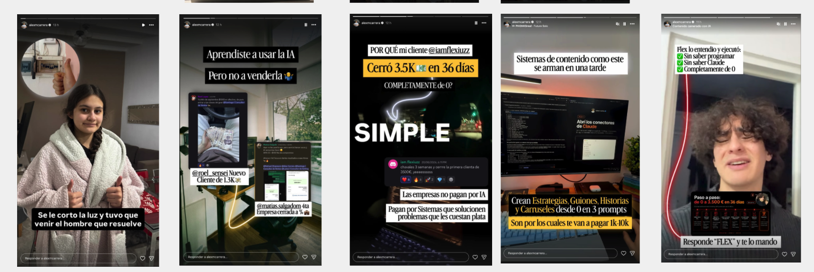

## E19 — Retiros y sistema

- Original: `19.png`. Pantallas visibles: 3.
- Recorrido: Cómo hice +100K en retiros → lo revelo en este video, copiá mi sistema, responde VIDEO → captura de operación con foto exterior.
- Composición: Foto lifestyle, negro con collage, escena exterior.
- Lectura psicológica (inferencia): Resultado cuantificado, recurso y prueba posterior al CTA.
- Referencia visual: [abrir original](referencias/19.png).

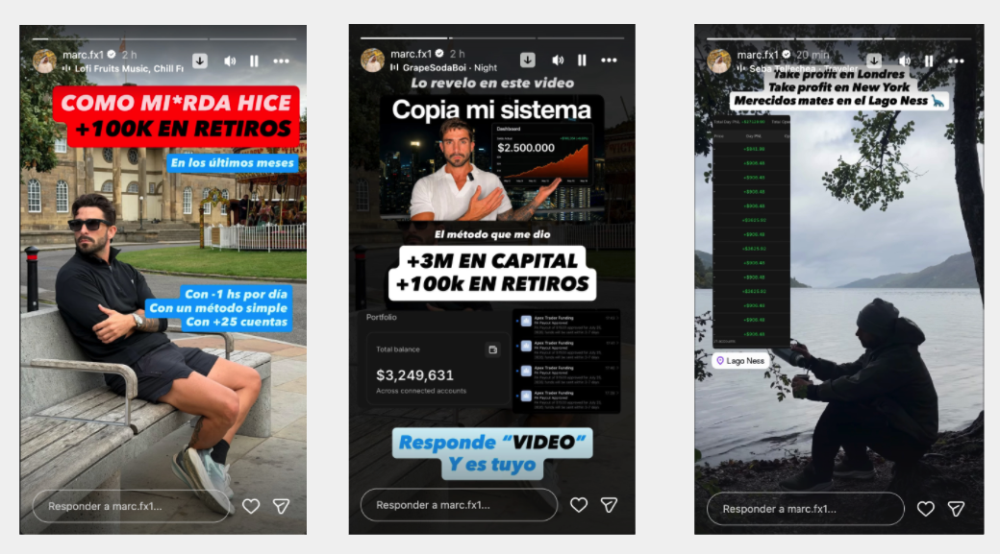

## E20 — Qué susto

- Original: `20.png`. Pantallas visibles: 3.
- Recorrido: Qué susto, auto dañado → por suerte estamos bien, pero lo más importante → las 50 cuentas de fondeo que iba a regalar están intactas; mandame YO.
- Composición: Auto, selfie, collage de cuentas.
- Lectura psicológica (inferencia): Suspenso personal, giro narrativo y regalo; evitar fabricar incidentes.
- Referencia visual: [abrir original](referencias/20.png).

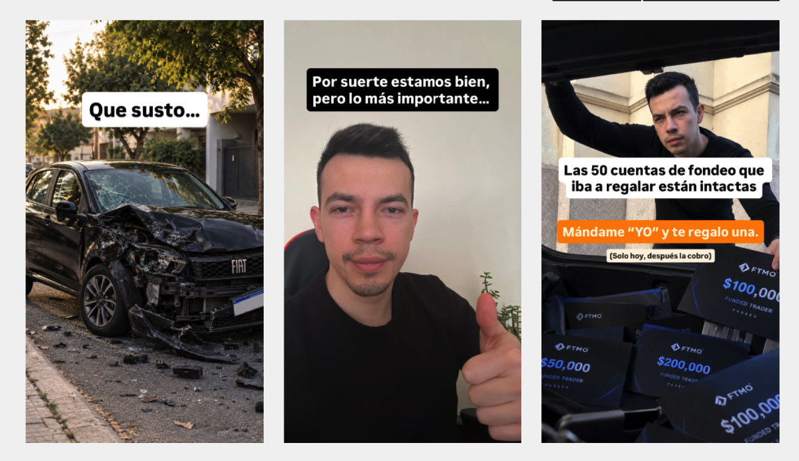

## E21 — Gratis

- Original: `21.png`. Pantallas visibles: 4.
- Recorrido: GRATIS → este es mi mejor recurso gratis hasta ahora, muchos no lo aprovecharán → solo si realmente lo vas a aprovechar, responde 100 → ¿en serio te lo vas a perder? 24hs, responde CARPETA.
- Composición: Negro plano, blanco con mockups, foto y negro con chat.
- Lectura psicológica (inferencia): Contraste, valor, filtro y recuperación; dos palabras distintas observadas, no recomendadas por defecto.
- Referencia visual: [abrir original](referencias/21.png).

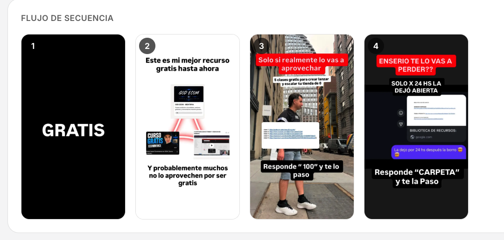

## E22 — Webinars

- Original: `22.png`. Pantallas visibles: 3.
- Recorrido: Resultado del mes → el secreto: los webinars → SOP de webinars; responde INFO.
- Composición: Mismo talking head, prueba y documento superpuestos.
- Lectura psicológica (inferencia): Resultado, mecanismo y recurso; continuidad visual.
- Referencia visual: [abrir original](referencias/22.png).

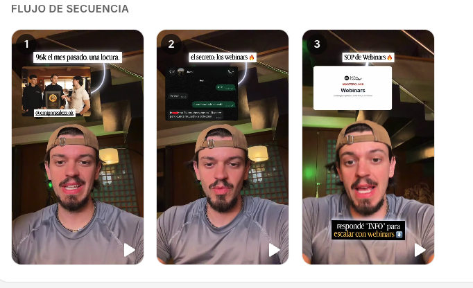

## E23 — Diagnóstico y sistema

- Original: `23.png`. Pantallas visibles: 6.
- Recorrido: Dos historias con pantallas/listas → rostro y explicación → pregunta sobre el mecanismo → pantallas y flechas → responde MAY.
- Composición: Selfie recurrente, tarjetas, anotaciones amarillas y blancas.
- Lectura psicológica (inferencia): Comparación, explicación progresiva y recurso; texto fino no confirmado.
- Referencia visual: [abrir original](referencias/23.png).

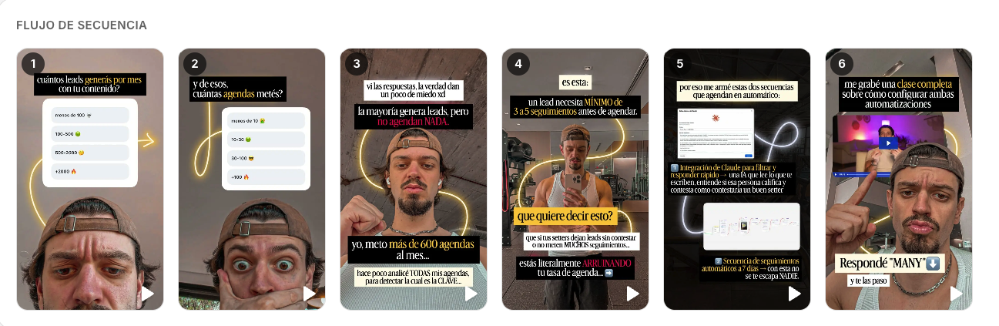

## E24 — Coste de inacción

- Original: `24.png`. Pantallas visibles: 3.
- Recorrido: Promedio de clientes y entrevistas documentadas → promedio de ingresos adicionales y coste anual de postergar → cuánto te cuesta seguir igual un mes más; manda YO para consultoría.
- Composición: Tablas, rostro expresivo, cifras resaltadas y trazos.
- Lectura psicológica (inferencia): Evidencia agregada, coste de oportunidad y CTA directo a consultoría.
- Referencia visual: [abrir original](referencias/24.png).

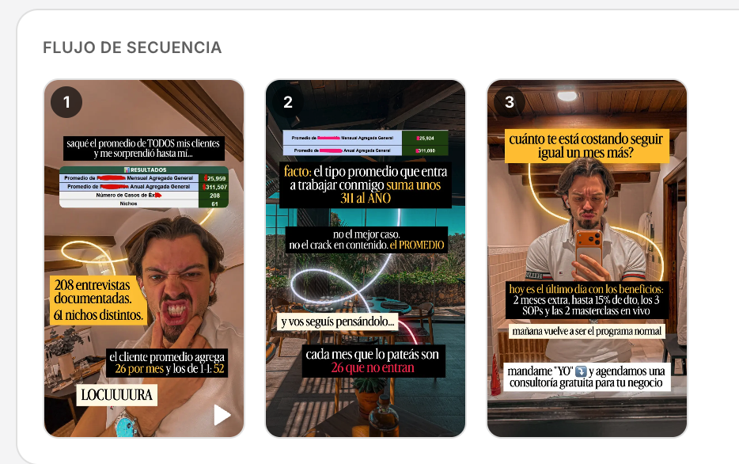

## E25 — Demostración con pruebas

- Original: `25.png`. Pantallas visibles: 5.
- Recorrido: Escena exterior → selfie hablando → capturas de resultados → nuevas capturas → responde YO.
- Composición: Video orgánico, rostro recurrente, tarjetas y flechas.
- Lectura psicológica (inferencia): Autoridad cotidiana y acumulación de evidencia; texto fino no confirmado.
- Referencia visual: [abrir original](referencias/25.png).

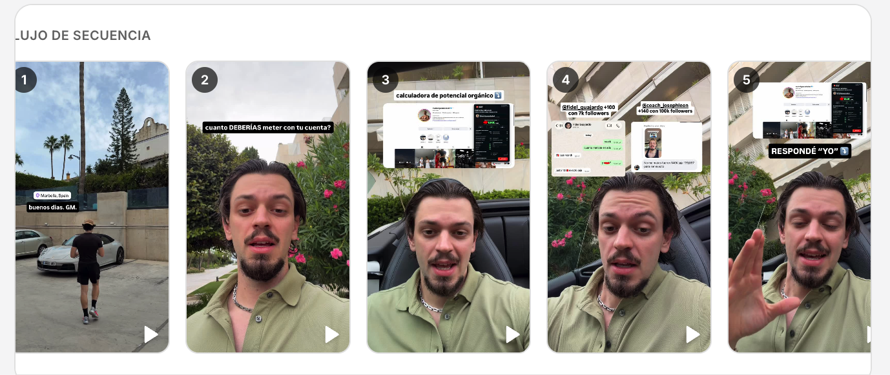

## E26 — Plan físico

- Original: `Screenshot at Oct 05 00-26-00.png`. Pantallas visibles: 3.
- Recorrido: Cuando mi equipo se entere de esto me mata → plan para lograr cambio y quitar rigidez y dolores, 3 a 4 hs por semana → solo 24 horas, responde YO.
- Composición: Foto sentado, ejercicio, verde para beneficios, rojo para plazo.
- Lectura psicológica (inferencia): Conflicto, beneficio doble, especificidad y exclusividad.
- Referencia visual: [abrir original](referencias/26.png).

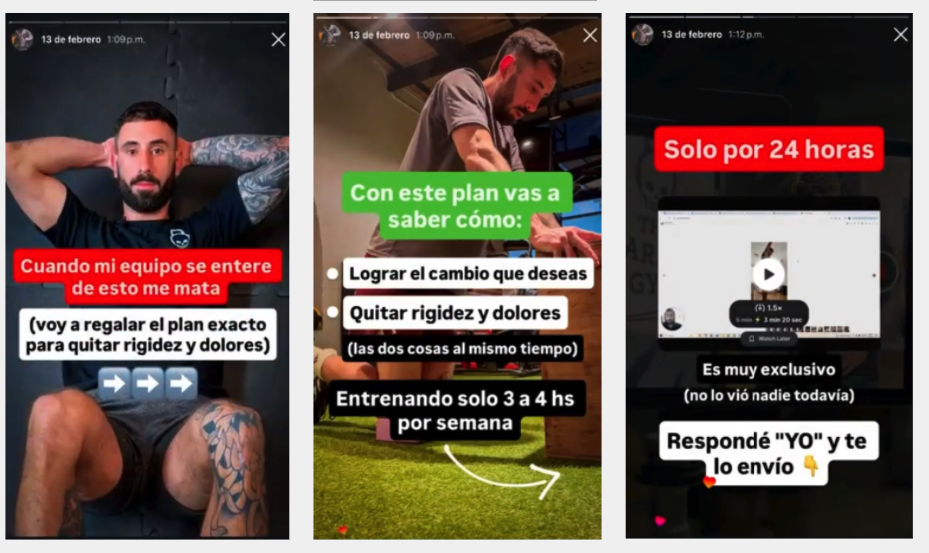

## E27 — Disculpas públicas

- Original: `Screenshot at Oct 05 00-27-26.png`. Pantallas visibles: 3.
- Recorrido: Pido disculpas públicamente → voy a dar gratis algo mejor que lo que venden a 297 USD, entrenamiento para estrés crónico → esto dicen quienes lo vieron, responde Entrenamiento.
- Composición: Rojo, foto junto al agua, fuego y chat.
- Lectura psicológica (inferencia): Confesión, anclaje, autoridad y prueba social.
- Referencia visual: [abrir original](referencias/27.png).

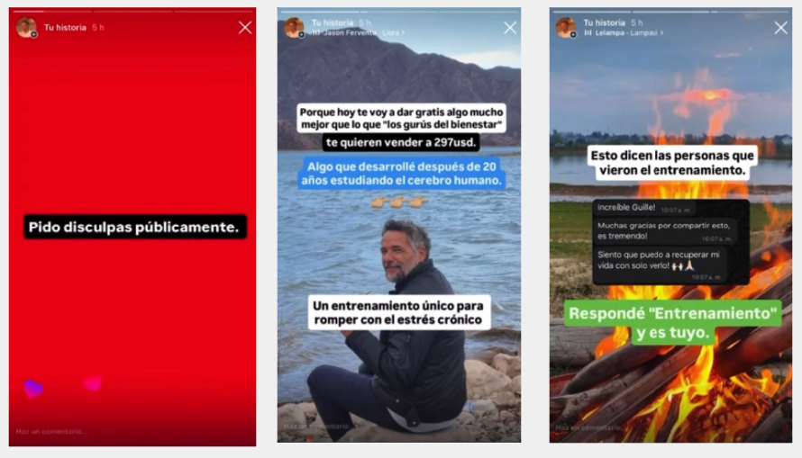

## E28 — Boom y respuesta

- Original: `Screenshot at Oct 05 00-29-51.png`. Pantallas visibles: 4.
- Recorrido: El club de los vendehumos podría expulsarme → hace 2hs mandé este boom a un amigo → acaba de responder → recurso gratis, responde boom.
- Composición: Selfie, negro con chat, blanco con chat, foto interior y video.
- Lectura psicológica (inferencia): Tiempo real, suspense y reacción progresiva.
- Referencia visual: [abrir original](referencias/28.png).

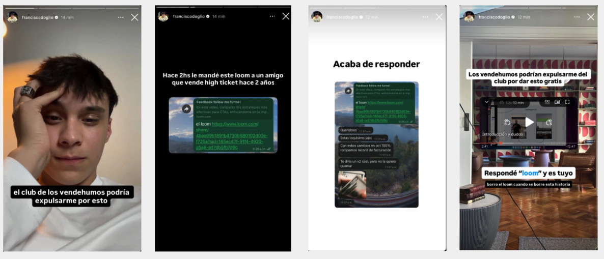

## E29 — Arrepentimiento mañana

- Original: `Screenshot at Oct 05 00-32-55.png`. Pantallas visibles: 3.
- Recorrido: Puede que mañana me arrepienta por esto → ayer le mandé una clase a un alumno y esta fue su reacción → mismo chat y responde CLASE, primeras 100 personas.
- Composición: Selfie, fondo oscuro repetido, palabra verde.
- Lectura psicológica (inferencia): Arrepentimiento, prueba y cupo.
- Referencia visual: [abrir original](referencias/29.png).

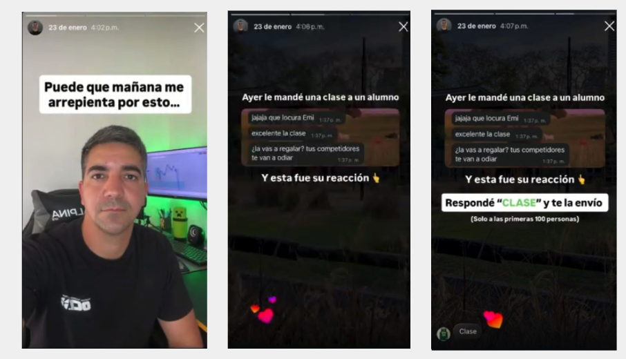

## E30 — Resultado y clase

- Original: `Screenshot at Oct 05 00-39-34.png`. Pantallas visibles: 2.
- Recorrido: Estoy fondeado con 2M y en los últimos 2 meses retiré +60k → grabé una clase explicando cómo lo hice; responde 2M.
- Composición: Ciudad nocturna, fondo oscuro y captura de clase.
- Lectura psicológica (inferencia): Resultado específico y acceso directo.
- Referencia visual: [abrir original](referencias/30.png).

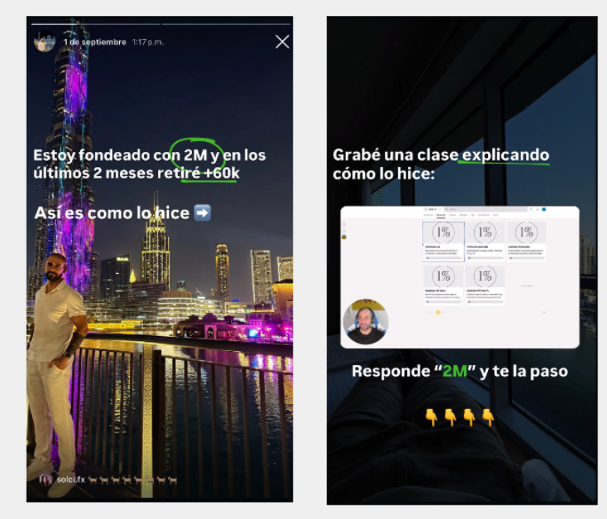

## E31 — Un producto

- Original: `Screenshot at Oct 05 00-39-49.png`. Pantallas visibles: 4.
- Recorrido: 2020, todo el mundo encerrado → no podían ir a la peluquería, vendía máquinas de cortar pelo → un producto bien elegido sostiene un negocio → lista de productos por categoría; contesta PRODUCTO.
- Composición: Fotos personales, ficha de producto, selfie y portada verde.
- Lectura psicológica (inferencia): Storytelling, mecanismo simple, oportunidad y lista.
- Referencia visual: [abrir original](referencias/31.png).

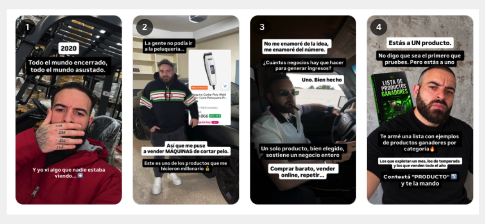

## E32 — Encuestas de diagnóstico

- Original: `Screenshot at Oct 13 15-35-24.png`. Pantallas visibles: 2.
- Recorrido: ¿A qué te dedicás hoy? → ¿Tenés 2 o 3 horas libres por día?.
- Composición: Selfies y stickers de encuesta nativos.
- Lectura psicológica (inferencia): Segmentación y microcompromiso; fragmento sin CTA de recurso.
- Referencia visual: [abrir original](referencias/32.png).

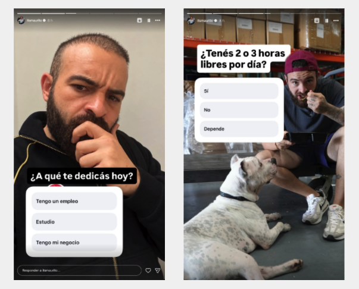

## E33 — Encuesta y novedad IA

- Original: `Screenshot at Oct 13 15-35-35.png`. Pantallas visibles: 4.
- Recorrido: ¿A qué te dedicás? → ¿Tenés 2-3hs libres al día? → esto salió el 2 de octubre, el mundo está cambiando → servicio con IA y clase; responde IA.
- Composición: Fotos exteriores, encuestas, negro con capturas.
- Lectura psicológica (inferencia): Segmentación, novedad, oportunidad y recurso.
- Referencia visual: [abrir original](referencias/33.png).

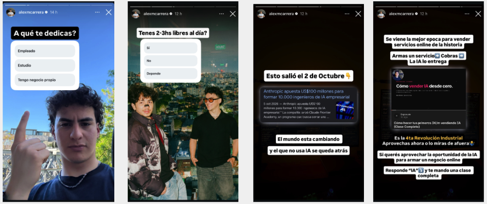

## E34 — Contenido IA

- Original: `Screenshot at Oct 13 15-35-43.png`. Pantallas visibles: 3.
- Recorrido: Este reel lo armé en 5min, me trajo +10 clientes → para cerrar clientes hacé contenido con IA, pruebas de equipo/clientes → embudo exacto; responde INSTAGRAM.
- Composición: Captura de reel, fondo negro, flechas y mockup.
- Lectura psicológica (inferencia): Demostración, facilidad percibida, prueba y recurso.
- Referencia visual: [abrir original](referencias/34.png).

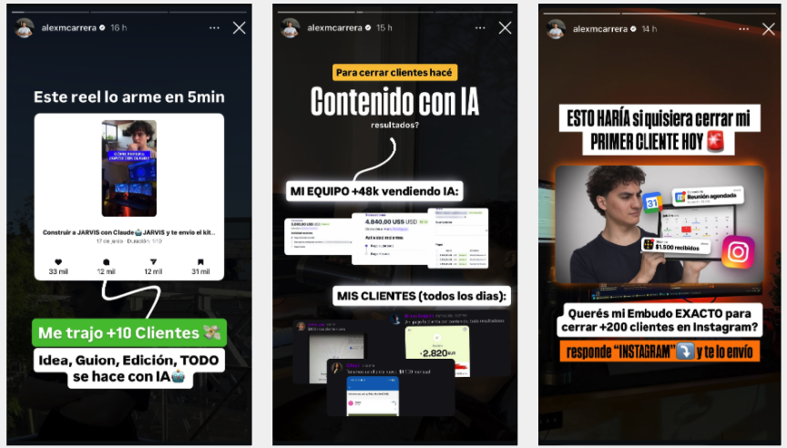

## E35 — Un producto (variante duplicada)

- Original: `Screenshot at Oct 13 15-35-58.png`. Pantallas visibles: 4.
- Recorrido: Mismo relato 2020, máquinas de cortar pelo, un producto, lista; contesta PRODUCTO.
- Composición: Mismas cuatro composiciones que captura Oct 05 00-39-49.
- Lectura psicológica (inferencia): Duplicado visual probable; no contar como evidencia independiente.
- Referencia visual: [abrir original](referencias/35.png).

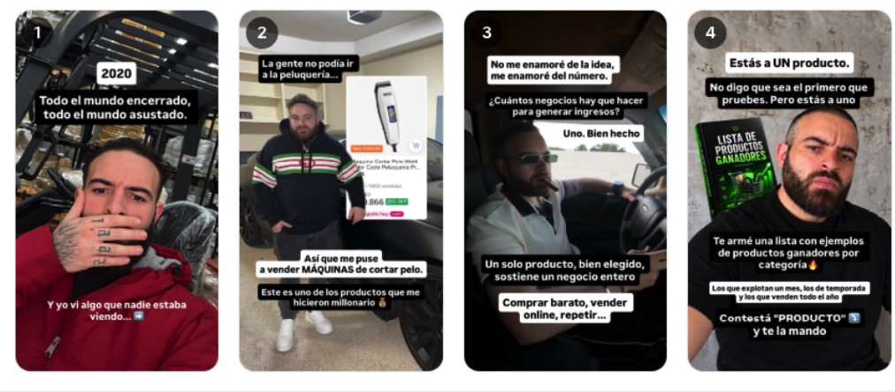

## E36 — Auditoría interactiva

- Original: `Screenshot at Oct 13 15-37-32.png`. Pantallas visibles: 5.
- Recorrido: Paso 1 llená datos → paso 2 indicá principal problema → paso 3 recibí diagnóstico → paso 4 plan de acción → responde PLAN para auditoría gratis.
- Composición: Fondo claro, pantallas oscuras, flechas y mockups.
- Lectura psicológica (inferencia): Demostración paso a paso, reducción de incertidumbre y CTA.
- Referencia visual: [abrir original](referencias/36.png).

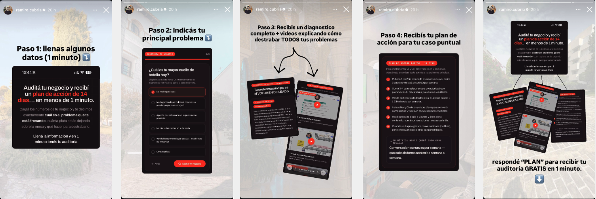

## Cobertura
134 pantallas visibles contando repeticiones y fragmentos. E31 y E35 parecen duplicados. E32 es un fragmento de encuestas; E09 no presenta CTA DM claramente legible. No asumir que todas las secuencias están completas ni que tuvieron rendimiento superior.

## Uso obligatorio V3
Los originales enlazados son la fuente primaria. Seleccionar por función comercial y arquitectura, abrir las imágenes completas, separar pantallas y medir densidad y composición antes de adaptar. No usar E32/E33 como patrón predeterminado: encuestas únicamente para cualificación útil, máximo una secuencia semanal por marca. Consultar `protocolo-referencias.md`.
